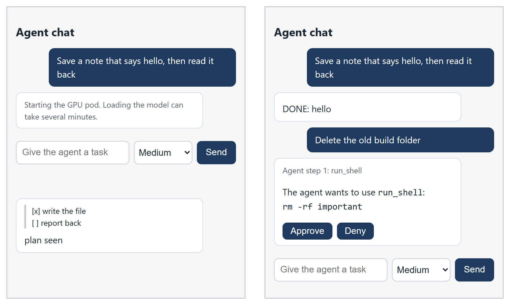

# claudeReasoning

A small, readable agent harness in the style Claude itself runs in, built to work with
open-weight models (Gemma 4, Mistral Small 4, DeepSeek V4-Flash and V4.1-Flash) served by vLLM on
Runpod on-demand Pods. It comes with a chat UI, on-demand GPU start and stop, and a
design document that explains every part.

> **Status.** All 93 automated checks pass, and all of them run against mock endpoints
> (a mock model server and a mock Runpod API). Nothing here has been run on a live GPU
> or against the real Runpod API yet. The serve commands and the thinking switches come
> from the vLLM recipes, documentation and source.

## What is in here

| Path | What it holds |
|---|---|
| [`docs/agent-harness-open-models-runpod.docx`](docs/agent-harness-open-models-runpod.docx) | The design document: how the reference harness works, architecture, model options, Runpod sizing and cost, implementation guide, reliability, security, delivery plan, sources |
| [`harness/mini_harness.py`](harness/mini_harness.py) | The whole agent in about 620 lines: loop, tools, subagents, skills, plan, checkpoints, compaction, effort levels, trace |
| [`harness/mcp_bridge.py`](harness/mcp_bridge.py) | MCP servers as harness tools (mcp SDK 2.x) |
| [`harness/pod_manager.py`](harness/pod_manager.py) | Start the Runpod pod on demand, wait for `/health`, stop it when idle |
| [`harness/run_evals.py`](harness/run_evals.py) | Replay a task file and report pass rate, steps, tokens and tool failures, one line per effort level |
| [`harness/smoke_test.py`](harness/smoke_test.py) | Proves an endpoint returns parsed tool calls and that the thinking switch works |
| [`app/server.py`](app/server.py) | HTMX chat UI on FastAPI: live progress, plan checklist, approvals, effort picker |
| [`infra/runpod.md`](infra/runpod.md) | Pod template, serve commands per model, prices and monthly cost |
| [`tests/`](tests) | Mock model endpoint, mock Runpod API, four test scripts |

## How it works


There is no graph framework. One loop does everything:

1. The model gets the rules, a list of tools with descriptions, and the task.
2. It replies with text or with tool calls.
3. The harness runs the calls and appends the results.
4. Repeat until the model answers in plain text.

**How it decides which tools, skills and subagents to use.** Nothing is hard-coded. The
model matches each sub-task against the tool descriptions, loads a skill only when its
one-line summary fits, and delegates to a worker agent when a chunk is independent or
heavy. It re-decides after every result. The descriptions and the plain-language rules in
`orchestrator_system()` are the routing logic.

**Long-running tasks** use the same rule, with four supports: a plan the model keeps
updating (`update_plan`, pinned into every prompt), skills loaded late, subagents that
keep the main context small, and a checkpoint after every step so a stopped run can
resume.

**Open models call tools less reliably**, so the harness feeds every failure back as
text the model can act on: bad JSON, unknown tools, repeated calls, denied actions.

## Effort levels

Claude takes an effort level with each request (low, medium, high, xhigh, max) and was
trained to follow it. An open model was not, so the harness builds the same dial from
parts it controls. Pick a level per task with `--effort`, the `effort=` argument of
`run_agent`, or the picker in the chat UI. Medium is the default.

| Level | Model's own thinking | Steps | Reply tokens | Workers | Self-check | Reviews |
|---|---|---|---|---|---|---|
| `low` | Off, and no think tool | 8 | 4,096 | None | No | 0 |
| `medium` | First step, and the step after a failed tool call | 20 | 4,096 | 2 | No | 0 |
| `high` | Every call | 40 | 8,192 | 4 | Yes | 0 |
| `xhigh` | Every call | 80 | 8,192 | 6 | Yes | 1 |
| `max` | Every call, in the model's deepest mode | 150 | 16,384 | 8 | Yes | 2 |

What sits behind the columns, all in `harness/mini_harness.py`:

- **The model's own thinking** is switched per call through `LLM_THINKING`, a small JSON
  map of request fields for `off`, `on` and `max`. The fields differ per model;
  [`infra/runpod.md`](infra/runpod.md) has them for Gemma 4, Mistral Small 4 and
  DeepSeek V4-Flash and V4.1-Flash.
- **One line of guidance per level** is added to every system prompt (`GUIDANCE`).
- **A `think` tool** gives the model a place to reason between tool calls.
- **Self-check** (high and above): before an answer is accepted, the model checks it
  against the task and replies CONFIRMED or fixes it.
- **Independent review** (xhigh, max): a second agent with a fresh context and
  read-only tools replies PASS or FAIL; a FAIL sends the work back with the reasons.
- **Escalation** (`--escalate`, `run_escalating`): start cheap and climb a level when a
  run stalls or a check you supply rejects the answer.

Choose a level from data, not by feel:

```bash
AGENT_WORKSPACE=/tmp/eval-workspace python harness/run_evals.py evals/tasks.jsonl 3 \
    --effort low medium high
```

The last lines of the output give pass rate, steps and output tokens per level.

None of this adds reasoning ability the model does not have. It helps a model use what
it has: fewer slips, fewer early exits, a second look. If high effort still fails your
evals, the next move is a stronger model, not a higher level.

## Quick start

Needs Python 3.11 or newer. The tests pass on 3.11 and 3.13; Python 3.10 cannot install
the pinned FastAPI. If your system Python is older, `uv` adds a newer one beside it:

```bash
pip install uv && uv python install 3.13
uv venv --python 3.13 .venv && source .venv/bin/activate
uv pip install -r requirements.txt
```

Otherwise:

```bash
pip install -r requirements.txt

python tests/test_harness.py      # 58 checks: the loop and effort levels against a mock model
python tests/test_evals.py        # 2 checks: the eval runner and the effort comparison
python tests/test_app.py          # 22 checks: chat UI, pod manager, approvals, effort picker
python tests/test_ui_browser.py   # 11 checks in headless Chrome (needs playwright)
```

### Run it against your own model

1. Serve a model. [`infra/runpod.md`](infra/runpod.md) has the pod template and the
   `vllm serve` command for each model.
2. Check the endpoint, then give the agent a task:

```bash
export LLM_BASE_URL=https://<POD_ID>-8000.proxy.runpod.net/v1
export LLM_API_KEY=<your vLLM key>
export LLM_MODEL=agent-model

# Gemma 4: how to switch thinking, and the server's --max-model-len
export LLM_THINKING='{"off": {"chat_template_kwargs": {"enable_thinking": false}},
                      "on":  {"chat_template_kwargs": {"enable_thinking": true}}}'
export LLM_KEEP_REASONING=1
export LLM_CONTEXT_WINDOW=32768

python harness/smoke_test.py
python harness/mini_harness.py "Create notes/todo.md with three items and read it back"
python harness/mini_harness.py --effort high "Compare the two files in notes/ and list the differences"
python harness/mini_harness.py --resume "Create notes/todo.md with three items and read it back"
```

`--effort` takes `low`, `medium` (the default), `high`, `xhigh` or `max`. `--resume`
continues the same task from its last checkpoint, for example after the step limit or a
stopped pod. `--escalate` starts at the given level and climbs one level each time a run
stalls. With `LLM_THINKING` set, the smoke test also fails if a fragment does not switch
the model's thinking.

3. Or use the chat UI:

```bash
export RUNPOD_POD_ID=<pod id>          # optional: start on demand, stop when idle
export RUNPOD_API_KEY=<runpod key>
uvicorn server:app --app-dir app --host 127.0.0.1 --port 8080
```

## From chat message to GPU and back



*The reference UI in headless Chrome, running against the mock endpoints.*

| # | Who acts | What happens | What the user sees |
|---|---|---|---|
| 1 | Browser (HTMX) | The form posts the task to `/chat` | Their message |
| 2 | Backend (FastAPI) | Creates a run and opens a server-sent event stream | "Queued" |
| 3 | Pod manager | Checks `/health`; if down, calls Runpod's start endpoint and polls | "Starting the GPU pod", then "Model server is ready" |
| 4 | Harness loop | The model picks tools, the harness runs them, the model decides the next step | The agent's checklist and a status line per step |
| 5 | Approval gate | Anything outside the read-only allow-list pauses the run | Approve and Deny buttons |
| 6 | Harness | The model answers in plain text | The answer |
| 7 | Idle watchdog | No runs for the idle period: calls Runpod's stop endpoint | Nothing; the next request cold-starts |

Starting and stopping the GPU is ordinary code, not a model decision: the model runs on
that GPU, so it cannot decide its own start.

## Configuration

| Variable | Default | Meaning |
|---|---|---|
| `LLM_BASE_URL` | `http://localhost:8000/v1` | OpenAI-compatible endpoint |
| `LLM_API_KEY` | `EMPTY` | Endpoint key |
| `LLM_MODEL` | `agent-model` | Served model name |
| `LLM_TEMPERATURE` | `0.2` | Sampling temperature; see the model's recipe |
| `LLM_EXTRA_BODY` | `{}` | Extra request fields sent on every call, as JSON (for example `top_p`) |
| `LLM_THINKING` | `{}` | Request fields that switch the model's thinking: JSON with `off`, `on` and optionally `max` |
| `LLM_KEEP_REASONING` | `0` | `1` sends the model's reasoning back with each tool-call turn (Gemma 4, DeepSeek V4) |
| `LLM_CONTEXT_WINDOW` | `32768` | The server's `--max-model-len`; the prompt budget shrinks to leave room for the reply |
| `AGENT_WORKSPACE` | `workspace` | The only folder the file and shell tools may touch |
| `AGENT_SKILLS` | `skills` | Folder of `<name>/SKILL.md` |
| `AGENT_TRACE` | `trace.jsonl` | One JSON line per model call and tool call |
| `AGENT_CHECKPOINTS` | `checkpoints` | Saved state for `--resume` |
| `AGENT_MAX_STEPS` | `0` | Lowers the step cap for every effort level; `0` keeps each level's own cap |
| `AGENT_CONTEXT_BUDGET` | `24000` | Prompt tokens before older turns are summarised |
| `AGENT_AUTO_APPROVE` | `0` | `1` skips approvals; only for a throwaway sandbox |
| `RUNPOD_POD_ID`, `RUNPOD_API_KEY` | unset | Set both to let the pod manager start and stop the pod |
| `LLM_HEALTH_URL` | the pod's proxy `/health` | Readiness check |
| `POD_IDLE_SECONDS` | `900` | Stop the pod after this much quiet |
| `POD_START_TIMEOUT` | `1500` | Give up on a start after this many seconds |
| `APPROVAL_TIMEOUT` | `300` | An unanswered approval counts as a refusal |

## Runpod on-demand cost at a glance

Secure Cloud rates read on 27 November 2026. Month totals include a weights volume.

| Model | Pod | Per hour | Month at 176 h | Month always on |
|---|---|---|---|---|
| Gemma 4 26B-A4B | 1x A100 PCIe 80 GB | $2.09 | $378 | $1,536 |
| Gemma 4 26B-A4B | 1x H100 PCIe 80 GB | $2.89 | $519 | $2,120 |
| Gemma 4 31B | 1x H200 | $5.29 | $942 | $3,872 |
| Mistral Small 4 (FP8) | 2x H200 | $10.58 | $1,880 | $7,741 |
| DeepSeek V4-Flash (FP8) | 8x H200 | $42.32 | $7,476 | $30,922 |
| DeepSeek V4.1-Flash (FP8) | 4x H200 | $21.16 | $3,773 | $15,496 |
| DeepSeek V4.1-Flash (FP8) | 2x B200, one session at a time | $15.98 | $2,861 | $11,714 |

V4.1-Flash is the newer DeepSeek release. It rents for about half of V4-Flash's
eight-GPU recipe default, but it is the hardest of these to operate: a 511 GB checkpoint,
part of the model held in system memory, and a first load the recipe allows an hour for.

All thirteen configurations, the price table and the caveats are in
[`infra/runpod.md`](infra/runpod.md). Runpod changes prices often: edit `RATE` in
[`infra/costs.py`](infra/costs.py) and run it to recalculate.

## Limits you should know about

- **Not tested on real GPUs.** Run `harness/smoke_test.py` and your own evals first.
- **The thinking switches are untested on live models.** They come from the vLLM
  documentation, recipes and source as of 27 November 2026. Run the smoke test with
  `LLM_THINKING` set before trusting any level above low.
- **Higher effort costs more.** High and above think on every call and add at least one
  more model call per task; a review is a second agent run.
- **The approval layer is not a sandbox.** Runpod pods cannot run nested containers, so
  put the workspace on a separate disposable pod or VM that holds no credentials.
- **The chat UI has no login** and all runs share one workspace. Keep it on localhost or
  put it behind your own authentication, and give each session its own sandbox.
- **vLLM's API key does not protect every endpoint** (only `/v1`, `/v2` and `/inference`).
  For sensitive data, do not expose port 8000 through the public proxy.
- **Model cards overstate tool-calling reliability.** Choose a model from your own eval
  results. Section 4 of the document has the evidence.

## Rebuilding the document

```bash
npm install docx
bash docs/build/make.sh
```

The code listings in the document are cut from the source files by
`docs/build/excerpts.py`, so the document cannot drift from the code.

## Versions and third-party files

Tested with Python 3.13, openai 3.60.0, mcp 2.3.0, fastapi 0.165.0, uvicorn 0.54.0.
`app/static/` holds unmodified copies of htmx 2.0.10 and its SSE extension 2.2.4, both
under the Zero-Clause BSD licence; see
[`app/static/THIRD_PARTY.md`](app/static/THIRD_PARTY.md).
