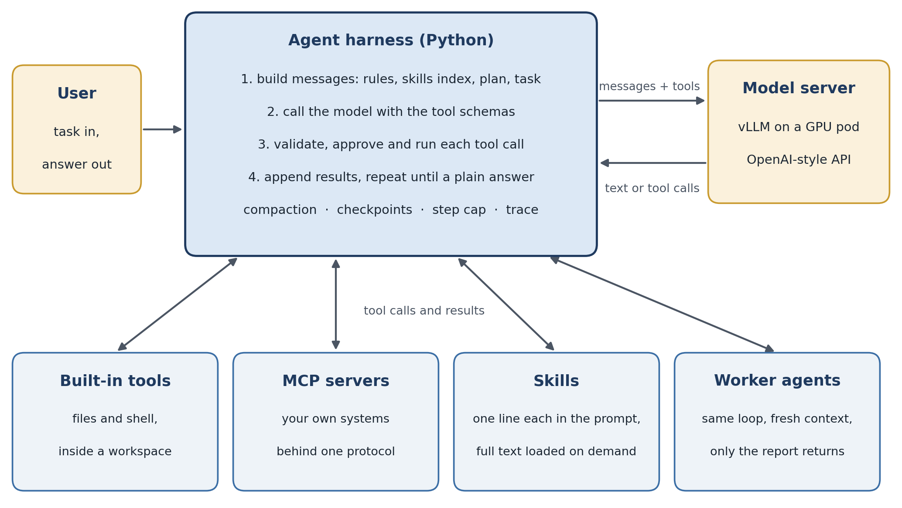

# claudeReasoning

A small, readable agent harness in the style Claude itself runs in, built to work with
open-weight models (Gemma 4, Mistral Small 4, DeepSeek V4-Flash and V4.1-Flash) served by vLLM on
Runpod on-demand Pods. It comes with a chat UI, on-demand GPU start and stop, and a
design document that explains every part.

> **Status.** Local automated checks use mock model/Runpod endpoints. The current
> local fixes were separately revalidated on one B300 with DeepSeek V4-Flash and
> vLLM 0.34.0 on 27 November 2026, using an uncommitted snapshot based on `f00e4ea`.
> Decode CUDA graphs replaced eager execution: the original workflow passed 17/17
> checks with independent PASS in 63.9 seconds under the unchanged 600-second limit.
> Four selected cases at low/medium passed 8/8 under the original 90-second limits.
> Failed eager baselines are preserved. This is not a full 18-case benchmark or
> production-readiness evidence; see [`infra/runpod.md`](infra/runpod.md) for the
> tested configuration, safety checks and remaining deployment-specific limits.

## What is in here

| Path | What it holds |
|---|---|
| [`docs/agent-harness-open-models-runpod.docx`](docs/agent-harness-open-models-runpod.docx) | The design document: how the reference harness works, architecture, model options, Runpod sizing and cost, implementation guide, reliability, security, delivery plan, sources |
| [`harness/mini_harness.py`](harness/mini_harness.py) | The agent loop, tools, subagents, skills, plan, checkpoints, bounded context, effort levels and trace |
| [`harness/mcp_bridge.py`](harness/mcp_bridge.py) | MCP servers as harness tools (mcp SDK 2.x) |
| [`harness/pod_manager.py`](harness/pod_manager.py) | Start the Runpod pod on demand, wait for `/health`, stop it when idle |
| [`harness/run_evals.py`](harness/run_evals.py) | Replay a task file and report pass rate, steps, tokens and tool failures, one line per effort level |
| [`harness/smoke_test.py`](harness/smoke_test.py) | Proves an endpoint returns parsed tool calls and that the thinking switch works |
| [`app/server.py`](app/server.py) | HTMX chat UI on FastAPI: live progress, plan checklist, approvals, effort picker |
| [`infra/runpod.md`](infra/runpod.md) | Pod template, serve commands per model, prices and monthly cost |
| [`tests/`](tests) | Mock model endpoint, mock Runpod API and five test scripts |

## How it works



There is no graph framework. One loop does everything:

1. The model gets the rules, a list of tools with descriptions, and the task.
2. It replies with text or with tool calls.
3. The harness runs the calls and appends the results.
4. Repeat until the model answers in plain text.

**How it decides which tools, skills and subagents to use.** Nothing is hard-coded. The
model matches each sub-task against the tool descriptions, loads a skill only when its
one-line summary fits, and delegates to a worker agent when a chunk is independent or
heavy. Each worker gets an explicit minimal tool list from its parent's capabilities;
it cannot gain tools, spawn another worker or change the main plan. Workers with
`load_skill` also see the skill index. Configured MCP tools participate in the same
routing and approval policy. The model re-decides after every result; descriptions and
`orchestrator_system()` are the routing logic.

**Long-running tasks** use the same rule, with four supports: a plan the model keeps
updating (`update_plan`, pinned into every prompt), skills loaded late, subagents that
keep the main context small, and a checkpoint after every step so a stopped run can
resume.

**Context is checked before every model request**, including summary requests. A
conservative serialized-JSON byte estimate includes messages and tool schemas, with
space reserved for the reply and 4,096 tokens of template overhead. This is not exact
model tokenization. Older history and oversized tool results are compacted without
orphaning tool replies; an oversized pinned task, plan or schema fails clearly instead
of silently truncating instructions. Extra request fields cannot override messages,
tools or reply limits.

**Open models call tools less reliably**, so the harness feeds every failure back as
text the model can act on: bad JSON, unknown tools, repeated calls, denied actions.

## Effort levels

Claude takes an effort level with each request (low, medium, high, xhigh, max) and was
trained to follow it. An open model was not, so the harness builds the same dial from
parts it controls. Pick a level per task with `--effort`, the `effort=` argument of
`run_agent`, or the picker in the chat UI. Medium is the default.

| Level | Model's own thinking | Steps | Reply tokens | Workers | Self-check | Review correction rounds |
|---|---|---|---|---|---|---|
| `low` | Off, and no think tool | 8 | 4,096 | None | No | 0 |
| `medium` | First step, and the step after a failed tool call | 20 | 4,096 | 2 | No | 0 |
| `high` | Every call | 40 | 8,192 | 4 | Yes | 0 |
| `xhigh` | Every call | 80 | 8,192 | 6 | Yes | 1 |
| `max` | Every call, in the model's deepest mode | 150 | 16,384 | 8 | Yes | 2 |

What sits behind the columns, all in `harness/mini_harness.py`:

- **The model's own thinking** uses `LLM_THINKING`, a JSON map of request fields for
  `off`, `on` and optionally `max` and `brief`. The default `LLM_THINKING_SCOPE=step`
  switches medium effort on its first step and after failed tools. Use `task` for
  conversation-level thinking: medium then uses `brief` throughout, or `on` if no
  `brief` is defined; low stays off and high stays on. The fields differ per model;
  [`infra/runpod.md`](infra/runpod.md) has them for each supported preset.
- **One line of guidance per level** is added to every system prompt (`GUIDANCE`).
- **A `think` tool** gives the model a place to reason between tool calls.
- **Self-check** (high and above): before an answer is accepted, the model checks it
  against the task and replies exactly CONFIRMED or gives the full corrected answer.
- **Independent review** (xhigh, max): a fresh-context agent with read-only tools must
  return PASS alone on its first non-empty line (case-insensitive). Any other verdict,
  including an empty or unfinished review, rejects the answer. Xhigh allows one
  correction round and max allows two; every corrected answer is reviewed again.
  Exhausting the budget returns an explicit stopped result, not an unreviewed draft.
  The reviewer receives runtime-observed tool arguments/results, including loaded skills
  and worker calls, alongside the task and answer, but not the coordinator's reasoning.
  It still inspects workspace artifacts; clipped evidence is explicitly incomplete.
  Checkpoints preserve these observations across compaction and manual resume, and the
  trace records reviewer verdicts for diagnosis.
- **Escalation** (`--escalate`, `run_escalating`): start cheap and climb a level when a
  run stalls or a check you supply rejects the answer.

Choose a level from data, not by feel:

```bash
AGENT_WORKSPACE=/tmp/eval-workspace python harness/run_evals.py evals/tasks.agent.jsonl 3 \
    --effort low medium high
```

The last lines of the output give pass rate, steps and output tokens per level.
`evals/tasks.agent.jsonl` contains 18 cases; `evals/tasks.example.jsonl` is the smaller
example. `--shard 0/2` and `--shard 1/2` split cases over two processes; use different
workspace, trace and checkpoint paths for each process. Each run's workspace is retained
under its output folder for inspection. Failed or stopped runs always fail grading,
even if their files satisfy an artifact-only check.

None of this adds reasoning ability the model does not have. It helps a model use what
it has: fewer slips, fewer early exits, a second look. If high effort still fails your
evals, the next move is a stronger model, not a higher level.

## Quick start

Needs Python 3.11 or newer. The local checks were run on Windows with Python 3.14.
If your system Python is older, `uv` adds a newer one beside it:

```bash
pip install uv && uv python install 3.13
uv venv --python 3.13 .venv && source .venv/bin/activate
uv pip install -r requirements.txt
```

Otherwise:

```bash
pip install -r requirements.txt

python tests/test_harness.py      # 126 checks: tools, context, review evidence, MCP config, workers and budgets
python tests/test_evals.py        # 5 checks: grading, failure scoring and effort comparison
python tests/test_eval_cases.py   # 43 checks: task graders, reference solutions and near-misses
python tests/test_app.py          # 34 checks: chat UI, pod manager, approvals and budget deadlines
python tests/test_ui_browser.py   # 22 checks in Chrome, including the complete skill/worker/MCP flow
```

All 230 checks passed locally on 27 November 2026. Browser checks additionally need
`pip install playwright` and installed Chrome or Chromium. Missing prerequisites produce
a skip, not verification. If HTTPX rejects an IPv6 entry in your proxy exclusions, run
local checks with `NO_PROXY=127.0.0.1,localhost no_proxy=127.0.0.1,localhost` for that
process only.

### Run it against your own model

1. Serve a model. [`infra/runpod.md`](infra/runpod.md) has the pod template and the
   `vllm serve` command for each model.
2. Check the endpoint, then give the agent a task:

```bash
export LLM_BASE_URL=https://<POD_ID>-8000.proxy.runpod.net/v1
export LLM_API_KEY=<your vLLM key>
export LLM_MODEL=agent-model

# Gemma 4: how to switch thinking, and the server's --max-model-len
export LLM_THINKING='{"off": {"chat_template_kwargs": {"enable_thinking": false}},
                      "on":  {"chat_template_kwargs": {"enable_thinking": true}}}'
export LLM_KEEP_REASONING=1
export LLM_CONTEXT_WINDOW=32768

python harness/smoke_test.py
python harness/mini_harness.py "Create notes/todo.md with three items and read it back"
python harness/mini_harness.py --effort high "Compare the two files in notes/ and list the differences"
python harness/mini_harness.py --resume "Create notes/todo.md with three items and read it back"
```

`--effort` takes `low`, `medium` (the default), `high`, `xhigh` or `max`. `--resume`
continues the same task from its last checkpoint, for example after the step limit or a
stopped pod. `--escalate` starts at the given level and climbs one level each time a run
stalls. With `LLM_THINKING` set, the smoke test also fails if a fragment does not switch
the model's thinking.

3. Or use the chat UI:

```bash
export RUNPOD_POD_ID=<pod id>          # optional: start on demand, stop when idle
export RUNPOD_API_KEY=<runpod key>
uvicorn server:app --app-dir app --host 127.0.0.1 --port 8080
```

### Configure MCP capabilities

MCP is opt-in: only an operator-controlled JSON configuration can launch servers or
connect them. The model cannot install a server or choose an arbitrary endpoint.
For the bundled arithmetic test server, a configuration contains:

```json
{
  "servers": {
    "demo": {
      "command": "python",
      "args": ["tests/demo_mcp_server.py"],
      "tools": ["add"]
    }
  }
}
```

Set `AGENT_MCP_CONFIG` to that file's absolute path and launch from the repository
root with the virtual environment activated. Both the CLI and chat UI connect the
configured servers and expose only allowlisted tools, named `demo__add` in this example.
All MCP calls still require approval; use the chat UI's Approve/Deny buttons. Unattended
CLI runs deny them unless explicitly configured with `AGENT_AUTO_APPROVE` in a sandbox.

A remote definition uses `url` and `tools` instead of `command` and `args`. For stdio
credentials, an optional `env` list names environment variables to pass through;
values stay in the environment, not the configuration or model prompt. Do not point
this configuration at untrusted executables. Connections close on normal CLI/UI shutdown.

### Shared execution budgets

The coordinator, workers, reviewers, compaction and effort escalation share one
execution budget. Before a model call starts, its conservative prompt estimate and
reply allowance are reserved atomically, so parallel workers cannot spend the same
remaining allowance. The reply cap shrinks to the remaining token/cost allowance
instead of rejecting a call solely because the full effort-level reply cap will not fit.
If the prompt plus even one reply token cannot fit, the run stops. Prompt estimation
remains conservative, not exact model tokenization. Complete usage releases unused
reservations; missing
usage and failed calls retain conservative accounting. Exhaustion returns a stopped
result, and escalation cannot reset the budget.

The defaults are 900 seconds and 100,000 total model tokens; `0` disables either cap.
`AGENT_MAX_COST_USD` optionally limits estimated model-token cost and requires positive
`LLM_INPUT_USD_PER_MILLION` and `LLM_OUTPUT_USD_PER_MILLION` prices for your endpoint.
Budget usage and stops are recorded in the trace. Model calls, shell execution, MCP
waits and approval waits use the remaining deadline; cancellation of in-flight remote
actions is best-effort and cannot undo their effects.

These limits cover agent execution, not preceding GPU/MCP startup or Runpod rental.
They are not a billing guarantee or an OS sandbox. Separate chat requests and manual
checkpoint resumes start fresh budgets; effort escalation within one invocation does not.

## From chat message to GPU and back


*The reference UI in headless Chrome, running against the mock endpoints.*

| # | Who acts | What happens | What the user sees |
|---|---|---|---|
| 1 | Browser (HTMX) | The form posts the task to `/chat` | Their message |
| 2 | Backend (FastAPI) | Creates a run and opens a server-sent event stream | "Queued" |
| 3 | Pod manager | Checks `/health`; if down, calls Runpod's start endpoint and polls | "Starting the GPU pod", then "Model server is ready" |
| 4 | Harness loop | The model picks tools, the harness runs them, the model decides the next step | The agent's checklist and a status line per step |
| 5 | Approval gate | Shell commands outside the checked read-only subset and all MCP calls pause the run; approvals are command-specific | Approve and Deny buttons, one request at a time |
| 6 | Harness | The model answers in plain text | The answer |
| 7 | Idle watchdog | No runs for the idle period: calls Runpod's stop endpoint | Nothing; the next request cold-starts |

Starting and stopping the GPU is ordinary code, not a model decision: the model runs on
that GPU, so it cannot decide its own start.

## Configuration

| Variable | Default | Meaning |
|---|---|---|
| `LLM_BASE_URL` | `http://localhost:8000/v1` | OpenAI-compatible endpoint |
| `LLM_API_KEY` | `EMPTY` | Endpoint key |
| `LLM_MODEL` | `agent-model` | Served model name |
| `LLM_TEMPERATURE` | `0.2` | Sampling temperature; see the model's recipe |
| `LLM_EXTRA_BODY` | `{}` | Extra request fields sent on every call, as JSON (for example `top_p`) |
| `LLM_THINKING` | `{}` | Request fields for `off`, `on` and optionally `max` and `brief` |
| `LLM_THINKING_SCOPE` | `step` | `task` keeps medium thinking on throughout, using `brief` if present |
| `LLM_KEEP_REASONING` | `0` | `1` sends the model's reasoning back with each tool-call turn (Gemma 4, DeepSeek V4) |
| `LLM_CONTEXT_WINDOW` | `32768` | Match the server's `--max-model-len`; requests reserve reply and template space |
| `AGENT_WORKSPACE` | `workspace` | File-tool boundary and shell working directory; approved shell commands are not jailed |
| `AGENT_SKILLS` | `skills` | Folder of `<name>/SKILL.md` |
| `AGENT_TRACE` | `trace.jsonl` | One JSON line per model call and tool call |
| `AGENT_CHECKPOINTS` | `checkpoints` | Saved state for `--resume` |
| `AGENT_MAX_STEPS` | `0` | Lowers the step cap for every effort level; `0` keeps each level's own cap |
| `AGENT_CONTEXT_BUDGET` | `24000` | Soft message-size estimate for compaction; the context-window preflight also includes schemas |
| `AGENT_MCP_CONFIG` | unset | Operator-controlled JSON file of approved servers and tool allowlists |
| `AGENT_MAX_SECONDS` | `900` | Shared agent-execution deadline; `0` disables it |
| `AGENT_MAX_TOTAL_TOKENS` | `100000` | Shared model-token allowance, including workers and summaries; `0` disables it |
| `AGENT_MAX_COST_USD` | `0` | Optional estimated model-token cost limit, not GPU rental |
| `LLM_INPUT_USD_PER_MILLION`, `LLM_OUTPUT_USD_PER_MILLION` | `0` | Endpoint token prices; both must be positive when a cost cap is set |
| `AGENT_AUTO_APPROVE` | `0` | `1` skips approvals; only for a throwaway sandbox |
| `RUNPOD_POD_ID`, `RUNPOD_API_KEY` | unset | Set both to let the pod manager start and stop the pod |
| `LLM_HEALTH_URL` | the pod's proxy `/health` | Readiness check |
| `POD_IDLE_SECONDS` | `900` | Stop the pod after this much quiet |
| `POD_START_TIMEOUT` | `1500` | Give up on a start after this many seconds |
| `APPROVAL_TIMEOUT` | `300` | An unanswered approval counts as a refusal |

## Runpod on-demand cost at a glance

Secure Cloud rates read on 27 November 2026. Month totals include a weights volume.

| Model | Pod | Per hour | Month at 176 h | Month always on |
|---|---|---|---|---|
| Gemma 4 26B-A4B | 1x A100 PCIe 80 GB | $2.09 | $378 | $1,536 |
| Gemma 4 26B-A4B | 1x H100 PCIe 80 GB | $2.89 | $519 | $2,120 |
| Gemma 4 31B | 1x H200 | $5.29 | $942 | $3,872 |
| Mistral Small 4 (FP8) | 2x H200 | $10.58 | $1,880 | $7,741 |
| DeepSeek V4-Flash (FP8) | 8x H200 | $42.32 | $7,476 | $30,922 |
| DeepSeek V4.1-Flash (FP8) | 4x H200 | $21.16 | $3,773 | $15,496 |
| DeepSeek V4.1-Flash (FP8) | 2x B200, one session at a time | $15.98 | $2,861 | $11,714 |

V4.1-Flash is the newer DeepSeek release. It rents for about half of V4-Flash's
eight-GPU recipe default, but it is the hardest of these to operate: a 511 GB checkpoint,
part of the model held in system memory, and a first load the recipe allows an hour for.

All thirteen configurations, the price table and the caveats are in
[`infra/runpod.md`](infra/runpod.md). Runpod changes prices often: edit `RATE` in
[`infra/costs.py`](infra/costs.py) and run it to recalculate.

### Disposable GPU validation

`infra/pod_test.sh` runs on the selected Linux GPU pod, not on your desktop. It supports
`gemma4`, `deepseek-v4` (one B300) and `deepseek-v41` (four H200), with `setup`, `serve`,
`smoke` and `evals` steps. It binds vLLM to localhost. See
[`infra/runpod.md`](infra/runpod.md) for settings, sharding, saved outputs and the
32K context used in the actual DeepSeek experiment. The script installs the then-current
vLLM; pin the tested image/model revision separately for reproducibility. It does not
stop the GPU or cap rental spending: export results and stop the pod yourself.

## Limits you should know about

- **Live coverage remains limited.** The graph-enabled B300 revalidation passed the
  scoped skill/worker/MCP workflow with strict independent review, plus four selected
  cases at low/medium. Failed eager baselines are preserved; this is not the full
  18-case benchmark. Run the smoke test and your own evals before deployment.
- **Most serving/thinking presets remain untested live.** Only the DeepSeek V4-Flash
  0731 configuration above had live protocol/thinking probes. Gemma, Mistral, V4.1,
  larger contexts and max-thinking configurations still need deployment-specific tests.
- **Higher effort costs more.** High and above think on every call and add at least one
  more model call per task; a review is a second agent run.
- **Workspace file writes are permitted without approval.** `write_file`, `edit_file`
  and plan updates may change files inside the workspace. MCP tools require approval.
  Automatic shell reads use checked literal workspace paths, a limited set of flags,
  and no shell expansion; other commands require approval. Recursive shell reads are
  not automatically approved because they can follow links outside the workspace.
- **The approval layer is not a sandbox.** Approved shell commands can access the host
  outside the workspace. Runpod pods cannot run nested containers, so put the agent on
  a separate disposable pod or VM that holds no credentials.
- **The chat UI has no login** and all runs share one workspace. Keep it on localhost or
  put it behind your own authentication, and give each session its own sandbox.
- **vLLM's API key does not protect every endpoint** (only `/v1`, `/v2` and `/inference`).
  For sensitive data, do not expose port 8000 through the public proxy.
- **Model cards overstate tool-calling reliability.** Choose a model from your own eval
  results. Section 4 of the document has the evidence.

## Rebuilding the document

```bash
npm install docx
bash docs/build/make.sh
```

The code listings in the document are cut from the source files by
`docs/build/excerpts.py`, so the document cannot drift from the code.

## Versions and third-party files

Tested with Python 3.13, openai 3.60.0, mcp 2.3.0, fastapi 0.165.0, uvicorn 0.54.0.
`app/static/` holds unmodified copies of htmx 2.0.10 and its SSE extension 2.2.4, both
under the Zero-Clause BSD licence; see
[`app/static/THIRD_PARTY.md`](app/static/THIRD_PARTY.md).
